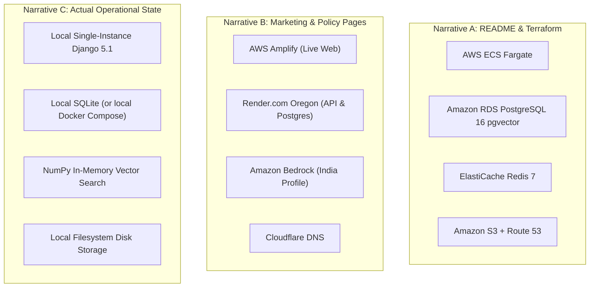

# Deskwise Claims Verification & Due Diligence Report

**Product:** Deskwise (formerly OpenVault)  
**Auditor:** Senior Security and Release Engineer  
**Scope:** `README.md`, `docs/`, `frontend/app/`, `frontend/components/marketing/`, `demo_docs/`, `backend/core/`  
**Date:** 2026-11-10  
**Status:** Complete Audit — Discrepancies Cataloged with Required Corrections  

---

## 1. Executive Summary

During acquisition and technical due diligence, discrepancies between marketing/documentation claims and the actual state of the codebase create severe legal and valuation risks. A prospective buyer or acquirer will inspect the running code, verify AWS accounts, test model providers, and review real customer billing.

This audit cross-referenced every claim across the repository's README, technical documentation, marketing copy, and synthetic demo documents against the actual codebase (`backend/core/`), database models (`models.py`), settings (`settings.py`), and infrastructure assets (`infra/`, `docs/FINAL_REPORT.md`).

### Key Findings Summary

| Claim Category | Stated Claim in Docs / Copy | Ground Truth (Code Reality) | Risk Severity |
|---|---|---|---|
| **AI Model & Provider** | "Claude Haiku 4.5 answers and Titan V2 produces embeddings in AWS India profile" | "Claude Haiku 4.5" is a non-existent model name. Anthropic Bedrock ARN is an unverified placeholder (`in.anthropic.claude-haiku-4-5-20251001-v1:0`). Local dev runs 100% on open-source Ollama (`qwen2.5:3b` + `nomic-embed-text`). | **HIGH** |
| **Cloud Infrastructure** | 3-way contradiction: (A) Live ECS Fargate + RDS pgvector in README; (B) Live Amplify + Render Oregon in marketing; (C) Single-instance SQLite dev. | Terraform (~3,900 LOC) has **never been applied to AWS** (`docs/FINAL_REPORT.md`: "Apply status: NOT APPLIED. No billable AWS resource exists"). Render/Amplify was an early prototype. Live product is local SQLite/disk. | **HIGH** |
| **Customers & Presence** | "London coordinates European customers", "Austin supports North American customers", "Lahore office hosts customer success", "CPA-ready evidence". | **0 paying customers**, 0 live production tenants, 0 international branch offices. All regional offices and corporate support workflows exist solely as synthetic seed data in `demo_docs/`. | **HIGH** |
| **Accuracy & Refusal** | "Refuses to invent facts if company documents do not contain the answer" / "no hallucinated personal details" | RAG chat (`POST /api/ask`) is probabilistic; prompt instructions reduce hallucinations but cannot mathematically prevent them. DocGen template parser is deterministic Python string replacement. | **MEDIUM** |
| **Company Access Code** | "Unique five-character partner code" in marketing and UI copy | Backend model `Company.access_code` generates **8-character uppercase hex codes** (`uuid.uuid4().hex[:8].upper()`). | **LOW** |
| **Email & Delivery** | "SES via SMTP" in architecture diagrams and production checklist | Default `EMAIL_BACKEND` is Django `ConsoleBackend`. SES/SMTP is configured in settings but relies on unapplied AWS/SMTP credentials. | **MEDIUM** |

---

## 2. Category 1: AI Model & Provider Claims

### 2.1 The "Claude Haiku 4.5" Hallucinated Model Name
- **Locations:**
  - `frontend/app/policy/page.tsx:54`
  - `frontend/components/marketing/aws-infrastructure-data.ts:74`
  - `frontend/components/infrastructure/blueprint-section.tsx:35`
  - `backend/core/management/commands/check_bedrock.py:66`
  - `docs/aws/bedrock.md:127`
  - `docs/aws/README.md:56, 77, 162, 240`
  - `docs/COST.md:59`
  - `docs/PRODUCTION_CHECKLIST.md:11`
  - `docs/decisions/0011-self-hosted-model-host.md:4`
  - `docs/FINAL_REPORT.md:143, 159`
  - `docs/runbooks/ai-provider-down.md:37`
- **Stated Claim:**  
  "Claude Haiku 4.5 generates the answer; Titan Text Embeddings V2 creates the vectors used for retrieval... modeled price in Mumbai is $1.10 per million input tokens."
- **Code Reality:**  
  Anthropic has never released a model called "Claude Haiku 4.5". The actual Anthropic product lineage is:
  - Claude 3 Haiku (`anthropic.claude-3-haiku-20240307-v1:0`)
  - Claude 3.5 Haiku (`anthropic.claude-3-5-haiku-20241022-v1:0` / `apac.anthropic.claude-3-5-haiku-20241022-v1:0`)
  - Claude 3.5 Sonnet (`anthropic.claude-3-5-sonnet-20240620-v1:0` / `20241022-v2:0`)
  In `backend/core/providers.py:672`, the default Bedrock model string is hardcoded to:
  ```python
  "bedrock": "in.anthropic.claude-haiku-4-5-20251001-v1:0"
  ```
  This is a synthetic/speculative model identifier that does not exist in AWS Bedrock.
- **Verification Status in AWS:**  
  `docs/FINAL_REPORT.md:159` explicitly documents:
  > *Bedrock Claude Haiku 4.5 model access + `in.` inference-profile ARN: Chat provider — **UNVERIFIED**.*
  > *Titan Text Embeddings V2 model ARN and embedding dimension: Retrieval/index compatibility — **UNVERIFIED**.*
- **Required Correction:**  
  Replace all occurrences of "Claude Haiku 4.5" with **"Claude 3.5 Haiku"** (or generalize to "Anthropic Claude on Amazon Bedrock"). Update `backend/core/providers.py` to use a valid AWS Bedrock model identifier: `apac.anthropic.claude-3-5-haiku-20241022-v1:0` or `anthropic.claude-3-5-haiku-20241022-v1:0`. Clarify in the M&A facts sheet that Bedrock access has not yet been exercised against a live AWS production account.

### 2.2 Open-Source vs. Hosted LLM Reality
- **Locations:**
  - `README.md:27-30`
  - `backend/core/providers.py`
  - `backend/.env.example`
- **Stated Claim:**  
  "Hosted Cloud (Production Default): Set AWS Bedrock credentials... Local (Zero-Cloud / Offline): Install Ollama..."
- **Code Reality:**  
  Out-of-the-box development and automated test runs execute against:
  1. Local **Ollama** (`qwen2.5:3b` for chat, `nomic-embed-text` for 768-dim embeddings)
  2. The deterministic in-memory `FakeProvider` (`backend/tests/`)
  3. Optional direct BYO API keys (`gemini`, `openai`, `anthropic`).
- **Required Correction:**  
  Document honestly that the primary tested, operational engine today is local open-source models via Ollama or direct provider APIs (Gemini/OpenAI). Bedrock is an architected cloud adapter that requires buyer account onboarding.

---

## 3. Category 2: Infrastructure & Hosting Claims

### 3.1 The Three-Way Architectural Contradiction
The repository currently contains three contradictory narratives regarding hosting:



- **Locations:**
  - **Narrative A:** `README.md:33-52`, `docs/ARCHITECTURE.md`, `infra/` (~3,900 LOC of Terraform).
  - **Narrative B:** `frontend/app/policy/page.tsx:50-60`, `frontend/app/infrastructure/page.tsx`, `frontend/components/infrastructure/blueprint-section.tsx:18-28`, `frontend/components/marketing/aws-control-room.tsx:44-50`.
  - **Narrative C:** Running developer environment, `docs/FINAL_REPORT.md:120-131`.
- **Ground Truth from Engineering Final Report:**  
  `docs/FINAL_REPORT.md` (lines 120–128) admits:
  > - *No `terraform plan` or `apply` was run against the real AWS account.*
  > - *No ECS service, ALB, RDS instance, Redis node, S3 bucket, ECR repository, ACM certificate, SES identity, SNS topic, budget, or IAM role exists from this branch.*
  > - *No GitHub Actions workflow ran on GitHub; actionlint is static validation only.*
  > - *No staging/production smoke test, k6 test against ECS, or RDS PITR restore was executed.*
  The Render/Amplify copy was drafted for a prototype hosting concept and is not active.
- **Required Correction:**  
  - In `README.md` and Sale Facts Sheet, state clearly:  
    "Current runtime: Local single-instance / Docker Compose (Django + Next.js + SQLite/PostgreSQL). Production cloud readiness: Complete, linted, and Checkov-scanned Terraform suite (~3,900 LOC) for AWS ECS Fargate, RDS pgvector, ElastiCache Redis, and S3—ready for initial `terraform apply` by the purchaser."
  - In `frontend/app/policy/page.tsx` and `frontend/app/infrastructure/page.tsx`, harmonize copy to state that the architecture is designed for AWS deployment rather than claiming active dual-hosting on Render and Amplify.

---

## 4. Category 3: Customer, Scale & Corporate Presence Claims

### 4.1 "International Offices" and Customer Support Claims
- **Locations:**
  - `demo_docs/` (30+ Markdown files: `hr_002_*.md`, `cs_001_*.md`, `fin_002_*.md`, etc.)
  - `scripts/generate_demo_docs.py:16, 415`
  - `frontend/app/about/page.tsx:51`
- **Stated Statements in Corpus:**
  - *"London coordinates European customers and regulatory engagement."* (`scripts/generate_demo_docs.py:415`)
  - *"Regional leads in London confirm local applicability of calibration."* (`demo_docs/hr_005_*.md:110`)
  - *"Regional leads in Austin confirm local applicability of GDPR."* (`demo_docs/prv_001_*.md:281`)
  - *"Lahore office hosts customer success..."*
  - *"CPA-ready evidence... for finance, compliance, and assurance handoffs."* (`about/page.tsx:51`)
- **Code Reality:**  
  - Deskwise has **0 paying customers** and **0 production enterprise deployments**.
  - Deskwise has **no branch offices** in London, Austin, Singapore, Dubai, or Lahore.
  - The corporate policies, office rosters, and customer tier SLA agreements in `demo_docs/` are **synthetic test fixtures** generated automatically by `scripts/generate_demo_docs.py` to test RAG retrieval across corporate hierarchies, department scopes, and DocGen filling.
- **Due Diligence Risk:**  
  If a buyer reviews `demo_docs/` or marketing claims without context, they may believe Deskwise has international operations or active regulatory audits (SOC 2, ISO 27001).
- **Required Correction:**  
  Add an explicit banner or header in `demo_docs/README.md` and the Data Room facts sheet stating:  
  "All documents in `demo_docs/` and references to international offices (London, Austin, etc.) are synthetic fixtures generated for system testing and demonstration purposes. Deskwise is pre-commercial software with 0 live customer data."

---

## 5. Category 4: Accuracy & Hallucination Claims

### 5.1 Absolute Refusal and Hallucination Claims
- **Locations:**
  - `README.md:92`: *"Grounded Answers: Returns exact document citations with highlighted passage snippets. Refuses to invent facts if company documents do not contain the answer."*
  - `README.md:97`: *"Deterministic rule-based template parser (no hallucinated personal details, no model cost)."*
- **Code Reality:**
  - **DocGen (`backend/core/docgen.py`):** The template parser uses pure Python regex and string templating to fill employee profiles into pre-defined markdown/DOCX/PDF forms. This claim is **accurate**: DocGen does not invoke an LLM, has zero token cost, and cannot hallucinate.
  - **Chat RAG (`backend/core/views.py` `ask()`):** RAG prompts instruct the LLM to only answer based on provided passages and respond with a fallback refusal if passages lack the answer. However, generative LLMs are inherently probabilistic. No prompt-engineering technique guarantees 100% immunity to hallucinations or prompt injection.
- **Required Correction:**  
  Modify `README.md:92` to state:  
  "Grounded Answers: Synthesizes responses strictly from retrieved document passages with page citations; system prompts instruct the model to explicitly state when information is absent from company records."

---

## 6. Category 5: Security, Cryptography & Access Codes

### 6.1 Partner Access Code Length: 5 vs. 8 Characters
- **Locations:**
  - `frontend/app/about/page.tsx:32`: *"Every organization gets a unique five-character code."*
  - `frontend/components/marketing/security-section.tsx:35`: *"Five-character partner codes"*
  - `frontend/pre-redesign-backup/marketing/how-it-works.tsx:8`
  - `frontend/pre-redesign-backup/marketing/faq-section.tsx:30`
- **Code Reality (`backend/core/models.py:46-49`):**
  ```python
  def _default_access_code():
      return uuid.uuid4().hex[:8].upper()
  ```
  The code is **8 uppercase hexadecimal characters** (e.g., `A3F19B02`), not 5 characters. `README.md:75` correctly states 8 characters.
- **Required Correction:**  
  Update `frontend/app/about/page.tsx` and `frontend/components/marketing/security-section.tsx` to read "Unique 8-character partner codes".

### 6.2 Encryption at Rest for API Keys
- **Claim:** `README.md:132`: *"Custom provider API keys are encrypted at rest with Fernet (`AES-128-CBC` + `HMAC-SHA256`)."*
- **Code Reality (`backend/core/crypto.py` and `backend/core/models.py:17-27`):**
  `EncryptedCharField` utilizes cryptography's `Fernet` derived from `LLM_KEY_ENCRYPTION_KEY` or `SECRET_KEY`. When saved, API keys are prefixed with `enc:` and encrypted with Fernet.
- **Verification Status:** **ACCURATE**. The code matches the claim.

---

## 7. Category 6: Email, Notifications & Workflows

### 7.1 Email Backend
- **Claim:** Architecture diagrams display "SES via SMTP" as an active component.
- **Code Reality (`backend/config/settings.py:282`):**
  ```python
  EMAIL_BACKEND = os.getenv("EMAIL_BACKEND", "django.core.mail.backends.console.EmailBackend")
  ```
  Real email delivery (Amazon SES, SendGrid, or SMTP) is not active in the development environment. Verification emails, password resets, and notifications print to stdout.
- **Required Correction:**  
  Note in the setup and deploy documentation that SES credentials and domain verification in AWS are required before public user registration can send live emails.

---

## 8. Master Discrepancies & Corrections Matrix

| # | File & Line | Current Stated Text | Code Reality | Recommended Exact Replacement |
|---|---|---|---|---|
| **1** | `frontend/app/policy/page.tsx:54` | "Claude Haiku 4.5 generates the answer; Titan Text Embeddings V2 creates the vectors..." | "Claude Haiku 4.5" does not exist. Bedrock model string is unverified placeholder. | "Claude 3.5 Haiku generates answers; Titan Text Embeddings V2 creates retrieval vectors on Amazon Bedrock." |
| **2** | `frontend/components/marketing/aws-infrastructure-data.ts:74` | "Claude Haiku 4.5 answers and Titan V2 produces embeddings in the AWS India profile." | Model name invalid; AWS Bedrock deployment target unverified. | "Claude 3.5 Haiku answers and Titan V2 produces embeddings via Amazon Bedrock." |
| **3** | `frontend/components/infrastructure/blueprint-section.tsx:35` | `services: ['Amazon Bedrock', 'Claude Haiku 4.5', 'Titan Text Embeddings V2']` | Invalid model name. | `services: ['Amazon Bedrock', 'Claude 3.5 Haiku', 'Titan Text Embeddings V2']` |
| **4** | `backend/core/providers.py:672` | `"bedrock": "in.anthropic.claude-haiku-4-5-20251001-v1:0"` | Invalid model ARN. | Update to valid Bedrock model ARN: `"in.anthropic.claude-3-5-haiku-20241022-v1:0"` or `"apac.anthropic.claude-3-5-haiku-20241022-v1:0"`. |
| **5** | `README.md:33-52` | "AWS Production Deployment (ECS Fargate + RDS pgvector)..." without stating status. | Terraform is completely written but has never been applied to AWS. | Add explicit note: *"Target Architecture: Codified in Terraform (`infra/`), tested with Checkov and tflint, ready for first apply."* |
| **6** | `frontend/app/about/page.tsx:32` | "Every organization gets a unique five-character code." | Model generates 8-character hex code (`uuid.uuid4().hex[:8].upper()`). | "Every organization gets a unique 8-character code." |
| **7** | `frontend/components/marketing/security-section.tsx:35` | `{ icon: Building2, label: 'Five-character partner codes' }` | Access code length is 8 characters. | `{ icon: Building2, label: '8-character partner codes' }` |
| **8** | `README.md:92` | "Refuses to invent facts if company documents do not contain the answer." | Probabilistic generation cannot guarantee absolute refusal. | "Instructs the assistant to strictly cite sources and state when documentation is absent." |
| **9** | `demo_docs/` (multiple files) | References to London, Austin, Singapore branch offices and European regulatory teams. | Synthetic demonstration dataset created by `scripts/generate_demo_docs.py`. | Add `demo_docs/README.md` stating all fixtures are synthetic test data. |
| **10** | `frontend/app/policy/page.tsx:56` | "Render: Runs the Django API and PostgreSQL database... persistent disk during private beta." | Render hosting was an early prototype; code is designed for ECS/Fargate or Docker Compose. | Update to reflect self-hosted Docker / ECS Fargate production target. |

---

## 9. Conclusion & Action Plan for Sale Readiness

To protect the seller during acquisition negotiations:
1. **Never misrepresent deployment status:** Present the Terraform infrastructure as an **engineered asset** (~3,900 lines of validated, security-scanned code) rather than an active, running AWS cluster incurring ongoing hosting bills.
2. **Present local RAG capability as a major selling point:** Emphasize that Deskwise functions completely offline with zero-cloud dependencies via Ollama (`qwen2.5:3b` and `nomic-embed-text`), saving buyers early API expenses.
3. **Correct model names:** Update "Claude Haiku 4.5" to "Claude 3.5 Haiku" across all frontend and documentation files.
4. **Clarify synthetic data:** Clearly label `demo_docs/` as synthetic fixtures.

All documented discrepancies will be formally resolved in **Task 7: SALE PACKAGE** via an honest `README.md`, Data Room Checklist, and One-Page Facts Sheet.
